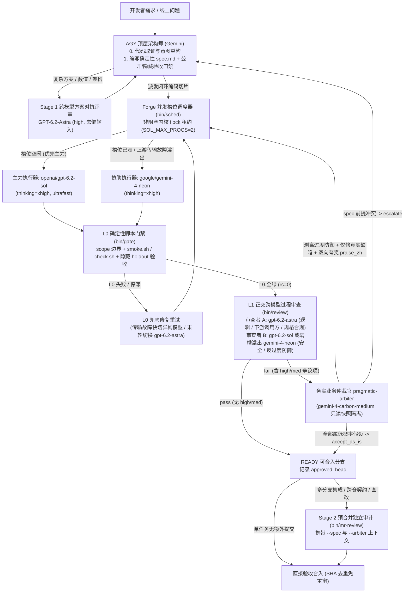

# AGY + Forge 跨模型多 Agent 工程研发架构

这是一套面向高并发真实业务研发的 **“顶层意图收敛 + 双模型并发调度执行 + 正交跨模型审查 + 务实业务仲裁（含双向正向激励）”** 闭环研发架构。

## 核心解决的痛点

1. **纯单模型高并发瓶颈**：所有编码子任务全推给单一主力模型（如 `openai/gpt-6.2-sol`）在多终端/批量并发时易触发上游限流、连接重置或排队阻塞；若静态切走又浪费主力编码模型在低负载窗口的高一轮通过率。
2. **审查过度防御与多轮空转**：静态代码审查模型倾向于提出“多重极端故障叠加假设”（如操作中途切实验组 + 滚动发布未排空），若缺乏业务裁判，执行器会不断堆砌冗余状态层与宽泛 `try/catch`，拖慢研发速度并污染代码。
3. **机械催办缺乏正向反馈**：长链路多 Agent 协作中若只有冷冰冰的报错打回，缺乏对具体工程亮点与审查贡献的认可。

---

## 整体架构图



---

## 关键机制设计

### 1. 优先 `gpt-6.2-sol` + 满载自动溢出 `gemini-4-neon (xhigh)` 调度器（`bin/sched`）
- **为什么不用 `ps` / `pgrep` 数进程**：Node CLI（如 `pi`）运行时会覆写 `process.title`，进程表无法可靠读取 `--model` 参数，且“先查数量再启动”存在毫秒级并发竞态（TOCTOU）。
- **非阻塞内核 `flock` 槽位租约**：
  - `bin/sched` 维护编号锁文件 `sol-slot-1.lock .. sol-slot-N.lock`（默认 `SOL_MAX_PROCS=2`，以 `O_CREAT | O_RDWR` **不带 `O_TRUNC`** 打开，`FD_CLOEXEC` 防止孙进程泄漏文件描述符）。
  - 任务启动时依次尝试 `flock(LOCK_EX | LOCK_NB)`：抢到槽位立即使用 `openai/gpt-6.2-sol`（`xhigh` + `ultrafast`）；槽位全满时**零排队等待**，立即溢出到 `google/gemini-4-neon`（`--thinking xhigh`）并行协助编码。
  - **编码槽位优先保护**：L1 审查者 B（`style`）通过只读 `pick-style` 观测槽位占用，当 `sol` 编码槽已满时自动切到 `gemini-4-neon`，既不在满载时给 `sol` 叠加额外连接，也绝不抢占 10 分钟级编码任务的 `sol` 槽位。
  - **上游故障快切**：若首轮因上游 `429` / `503` / 连接超时（`ETIMEDOUT` / `ECONNRESET`）导致 0 提交退出，下一轮自动避开故障模型并用完整 `spec.md` 开新会话快切，不浪费重试轮次。

### 2. 首轮即介入的务实业务仲裁（`pragmatic-arbiter` / `gemini-4-carbon-medium`）
- 在只读分离快照（隐藏 `.git` 与私有 holdout 验收脚本）上独立运行。
- **首轮证据纪律**：第 1 轮起即介入（`ARBITER_MIN_ROUND=1`）；对资金、账本、状态变更与可达 UI 调用链问题要求具体 `file:line` 反证才可驳回，同时当场剪除多重低概率巧合假设（若全部为过度防御项直接判 `accept_as_is` 结束循环，省去第 2~3 轮无意义返工）。
- **反膨胀指令（`simplify_directives` + `drop_issues`）**：明令禁止执行器为已驳回的边缘假设编写防御分支或冗余状态层。
- **双向具体正向激励（`praise_zh`）**：每轮仲裁结合真实代码亮点同时肯定执行者（如状态拆分干净、矩阵测试扎实）与审查者（如精准追踪游标或调用链边界），并传递至下一轮反馈与 `summary.txt`。

### 3. Stage 1 / Stage 2 双门禁与 SHA 去重
- **Stage 1（编码前方案对抗）**：顶层设计、数值经济模型与复杂根因结论在落代码前，将去偏后的客观约束与草案交由异构模型独立挑刺。
- **Stage 2（合并前 SHA 去重审计）**：已通过单仓 `forge`（`L0 gate` + `L1/arbiter`）且无后续手工/变基提交的同一 `(repo, base_sha, head_sha)` **不再重复跑 `mr-review`**；仅在多任务合并、跨仓 `--peer` 契约核验或直改分支时执行一次，并透传 `--spec` 与 `--arbiter` 防止重翻已裁决项。
- **参数化契约矩阵优先于多轮 LLM 猜想**：对多地区 × 多实验组等组合逻辑，优先编写秒级参数化矩阵单测放入 `check.sh`，替代慢速人工回归与多轮审查。

---

## 目录结构

- [`agy-config/GEMINI.example.md`](agy-config/GEMINI.example.md)：AGY 顶层全局协作规范模板（含两阶段对抗门禁、情绪价值规范、Forge 调度规则与工具链自检原则）。
- [`agents/pragmatic-arbiter.md`](agents/pragmatic-arbiter.md)：`pragmatic-arbiter`（Gemini 4 Carbon Medium）务实业务仲裁 Agent 定义。
- [`skills/forge/SKILL.md`](skills/forge/SKILL.md)：`forge` 技能定义（Frame -> Plan -> Scheduled Dispatch -> Accept）。
- [`forge-runtime/`](forge-runtime/README.md)：完整可运行的 `forge` 核心引擎与离线全链路测试套件（`bin/sched`、`bin/run`、`bin/gate`、`bin/review`、`bin/arbiter`、`bin/mr-review`、`bin/audit`、`bin/batch`、`tests/test_arbiter_pipeline.sh`）。
- [`scripts/agy-daily-retro-remind.py`](scripts/agy-daily-retro-remind.py)：每晚 19:30 自动汇总当日活跃会话与 Forge 轮次/耗时指标的只读复盘提醒脚本。

## 快速自检

无需配置任何外部 API Key，即可在本地用内置离线 Mock 运行完整 9 大场景回归测试（含并发槽位争抢溢出、上游故障快切、Carbon 剪枝、防篡改快照与信号回收）：

```bash
bash agy-forge-architecture/forge-runtime/tests/test_arbiter_pipeline.sh
```
